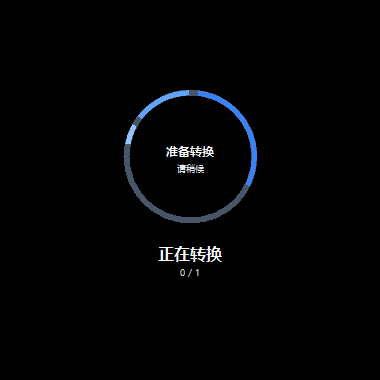

# ImgConvertToJpg · 图片格式转换器

Windows 右键菜单批量把图片转成 JPG 的小工具，没有主界面：选中图片、右键、转换，完成即退出。



## 功能

- 资源管理器多选图片 → 右键 →「显示更多选项」→「转换为 JPG」
- 统一输出 100% 质量 JPG（4:4:4 无色度抽样）
- 可选保留 Exif、透明区域填充色、同名文件处理策略（见 `settings.ini`）
- 多选自动合并为一批处理，转换完成自动退出
- 支持常驻后台，减少重复启动开销

## 安装

1. 从 Releases 下载压缩包，解压到 `C:\Tools\ImgConvertToJpg`
2. 确认主程序路径为 `C:\Tools\ImgConvertToJpg\ImgConvertToJpg.exe`（右键菜单按此固定路径注册）
3. 双击 `注册.reg`，写入当前用户注册表（HKCU，无需管理员）
4. 取消安装：双击 `卸载.reg`

> 主程序文件名固定为 `ImgConvertToJpg.exe`，升级时直接覆盖该文件即可，无需重新导入注册表。

## 使用

选中一张或多张图片 → 右键 →「显示更多选项」→「转换为 JPG」。

输出文件与原图同目录。默认不覆盖已存在的 JPG，自动追加序号。

## 命令行

```text
ImgConvertToJpg.exe --convert <文件...>    转换指定图片（右键菜单调用）
ImgConvertToJpg.exe --background           常驻后台，等待转换请求
ImgConvertToJpg.exe --quit                 退出常驻实例
ImgConvertToJpg.exe --version              显示版本
```

## 配置

`settings.ini` 与 exe 同目录，修改保存后下一次转换生效。

| 键 | 说明 | 默认 |
|---|---|---|
| `KeepExif` | 1 保留 Exif，0 丢弃 | `1` |
| `Background` | 透明图片填充的背景色（#RRGGBB） | `#FFFFFF` |
| `Overwrite` | 1 覆盖同名 JPG；0 自动加序号 | `0` |

## 构建

```powershell
python -m pip install pillow pyinstaller
pyinstaller ImageConverter.spec
# 输出：dist\ImgConvertToJpg.exe
```

## 目录结构

```text
main.py                 入口
imgconv/                转换核心（config / converter / formats / overlay / runtime / cli / app）
assets/app.ico          程序图标
ImageConverter.spec     PyInstaller 打包配置
version_info.txt        exe 版本信息
settings.ini            配置模板
注册.reg / 卸载.reg      右键菜单与开机自启的注册/卸载脚本
```

## 说明

- 只写入 `HKEY_CURRENT_USER`，不修改系统级注册表
- 支持 Windows 10 / 11；Windows 11 的右键菜单在「显示更多选项」中
- exe 未签名，首次运行可能触发 SmartScreen 提示

## 许可

本项目采用自定义非商业许可：自由复制、修改，禁止商业使用；整合或再分发时必须注明出处（Jon.Shen，Jon.Shen@Foxmail.com）。详见 [LICENSE](LICENSE)。

## 相关工具

- [世界时钟动态壁纸](https://github.com/JonShenzl/world-clock-wallpaper)
- [公网IP查询](https://github.com/JonShenzl/public-ip-query)
